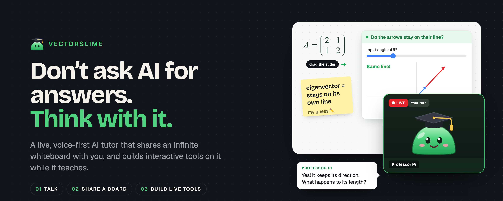

# VectorSlime



**A shared space where people and AI think together.**

▶ **[Watch the 1-minute demo](https://drive.google.com/file/d/1zrQhfs-n_RYlwbOx90cUG2JTSBTSd4Yz/view?usp=sharing)** · 📊 **[Pitch deck](https://docs.google.com/presentation/d/1TQFs5J7377A8eeb0-06NU4ot2Xxcqv9RLK3yOMslZkM/edit?usp=sharing)**

Today's AI tutors are chatbots: you type a question and get back a wall of text. That made sense when AI could only produce text. Models can now see, talk, draw, and write working software in seconds, and a chat box hides most of that. VectorSlime is built for what AI can do now. The student and the AI talk out loud and work on the same infinite whiteboard. Both of them can write, draw, point at things, and build on each other's work, and the AI can turn an idea into a live, interactive tool right on the board.

We think this is what working with AI will look like: neither a chat log nor an autopilot, but a shared workspace where both sides can see and change the same things. The more capable models become, the more there is to share in that space.

**Where we start: logical thinking.** The first use is one-on-one tutoring in math and logical reasoning. This is where chatbots fail students most: they hand over answers, and the student never builds the reasoning. VectorSlime teaches in short Socratic turns. The tutor asks one question, waits, looks at the student's work, and gives only the next idea they need. When a concept is visual, it builds a slider, graph, or simulation the student can explore.

**Where it goes next.** The same interface (voice, a shared canvas, and AI that can create live tools) works well beyond tutoring:

- **Education** in any subject: science, programming, languages, test prep.
- **Brainstorming:** the AI sketches, groups, and builds on ideas alongside you.
- **Discussions and debates:** arguments laid out on the board, with the AI questioning them.
- **Group work:** several people and an AI on one canvas.

## What it does today

The student talks with an AI tutor (a soft-body slime in a graduation cap) by voice and shares an infinite whiteboard with it. The student can draw, type, and embed webpages. The tutor can see the board and add equations, notes, diagrams, arrows, and **interactive mini web apps** (sliders, graphs, simulations) that the student uses right on the canvas. It looks like a livestream: the tutor appears on a stream cam, with live captions.

| Part | Default | Alternatives |
| --- | --- | --- |
| Brain (LLM) | Subscription gateway at `127.0.0.1:8787` (OpenAI-compatible proxy for the `claude` / `gemini` CLIs), model `claude-haiku` | [oMLX](https://github.com/jundot/omlx) on Apple Silicon, Ollama, LM Studio, any OpenAI-compatible server, OpenAI API, Anthropic API |
| Ears (speech-to-text) | Parakeet TDT 0.6B v3 on oMLX | Whisper in the browser (transformers.js, WebGPU/WASM), any OpenAI-compatible `/audio/transcriptions` server |
| Voice (text-to-speech) | Kokoro-82M in the browser (kokoro-js) | macOS system voice, any OpenAI-compatible `/audio/speech` server (OpenAI, mlx-audio, Kokoro-FastAPI) |
| Whiteboard | [tldraw](https://tldraw.dev) | |

Everything can run locally (oMLX for the model and speech-to-text, Kokoro in the browser for the voice).

## Setup

```bash
npm install
cp .env.example .env   # server-side fallbacks for base URLs and API keys
npm run dev            # http://localhost:3000
```

1. **Choose a model.** The app starts set to the subscription gateway (`GATEWAY_BASE_URL`, default `http://127.0.0.1:8787/v1`). The gateway is **not part of this repo**. If you aren't running one, open **Settings** and pick another provider:
   - **Fully local:** start oMLX (default `http://127.0.0.1:11434/v1`) and download an LLM. A **vision** model (e.g. Gemma 4, Qwen-VL) works best for "check my work". A fast MoE model such as Qwen3.6-35B-A3B works well for quick text-only turns.
   - **Hosted:** choose Anthropic or OpenAI and paste an API key (or set `ANTHROPIC_API_KEY` / `OPENAI_API_KEY` in `.env`).
2. **Speech-to-text** uses Parakeet on oMLX by default (download `mlx-community/parakeet-tdt-0.6b-v3`). Without oMLX, switch to in-browser Whisper in Settings.
3. On the dashboard, choose a course, homework help, or an open session. Every session starts on a fresh board: the previous board and chat are cleared, and course progress is kept. **End session** on the tutor cam takes you back to the dashboard.
4. The first time you go live, the browser downloads the Kokoro voice model (about 90 MB) and caches it. Going live also warms up Parakeet on oMLX.

Settings, including API keys, are stored in your browser and sent only to this app's own server routes. Keys in `.env` are used as server-side fallbacks.

## Using it

- **Talk:** hands-free mode detects when you speak; push-to-talk mode means you hold the mic button. Use headphones if you turn on "interrupt the tutor when I talk".
- **Type:** use the input under the tutor.
- **Board:** use the tldraw tools to draw, write, add sticky notes, and paste images. The globe button embeds a webpage (Desmos, GeoGebra, YouTube… some sites block embedding).
- **Teaching style:** the tutor teaches in short turns. Each turn gives you only the idea you need next, then ends with one question or one thing to try, and waits ("Your turn" on the cam; the question stays on screen). Anything the model says after its question is dropped, and turns are capped at 4 sentences. Quiz widgets can hand the turn back with a Check button (`tutor.submit`).
- **Courses:** pick "Linear Algebra" in the Today's plan panel for a 12-lesson course, from vectors to eigenvectors. Each lesson becomes the day's plan, and the tutor follows its steps using teaching notes and an answer key, checking your answers without reading them out. When a lesson is done, the panel (or the tutor, when you say you're ready) opens the next one on a fresh part of the board. Progress is saved; "All lessons" jumps anywhere. Courses live in `lib/courses/` and new ones are plain data.
- **Homework walkthrough:** drop a PDF (or a photo) on the "Today's plan" panel at the top left. The pages go on the board, and the tutor builds a plan for the day: the concepts the homework needs, in order, then the problems themselves. Each step has a time estimate and a "Teach me" button. The tutor follows the plan and marks steps done as you show you understand them. Scanned PDFs and photos need a vision model.
- **Check my work:** select what you wrote and press the eye button. The tutor gets the selection and a screenshot of the board.
- **Widgets** are interactive whenever you hover them with the select tool. Drag them by their title bar. What you do in a widget (e.g. moving a slider) is reported back to the tutor on your next turn.

## How it works

```
mic → energy VAD → Parakeet ┐
typed text ─────────────────┼─► /api/tutor (AI SDK streamText) ──► streamed text
board summary + PNG ────────┘                                         │
                                       ActionStreamParser ◄───────────┘
                                       ├─ plain text → sentence chunks → TTS → audio (+ lip sync, captions)
                                       └─ <board tool="…">…</board> → tldraw shapes
```

Each `<board>` tag runs at its position in the speech, so things appear (and the tutor's focus moves) as the tutor talks about them. Besides content (equations, notes, widgets, diagrams, webpages), the tutor can direct attention: `spotlight` dims everything except one shape or region, `point` glides a pointer to it, `emphasize` highlights part of an equation, and `focus` moves the camera. Shapes the tutor names (`id="eq1"`) can be targeted later in the same reply.

The tutor writes board actions as inline tags (`lib/agent/prompt.ts`) rather than as native tool calls. Local models emit raw HTML and LaTeX far more reliably this way than inside escaped JSON, and it works with any provider.

| Path | What |
| --- | --- |
| `app/api/tutor` | LLM proxy; streams text, forwards upstream errors in-band |
| `lib/agent/` | System prompt, streaming tag parser, speech cleanup |
| `lib/courses/` | Course content (Linear Algebra) and the course runner |
| `lib/plan/` | Homework reading (pdf.js from jsDelivr), plan prompt/parsing, plan store |
| `app/api/plan` | Turns homework text and page images into a day plan (JSON) |
| `lib/board/` | Board summary and snapshot, auto-placement, applying tutor actions, focus state |
| `lib/session/tutor.ts` | Turn loop: context → stream → board + speech; mic, VAD, barge-in |
| `lib/providers/` | LLM, STT, and TTS provider adapters |
| `components/board/shapes/` | `widget` (sandboxed iframe) and `math` (KaTeX) shapes |
| `lib/slime/physics.ts` | Soft-body physics: spring-connected nodes, gas pressure, tassel rope |
| `components/tutor/` | Stream cam, slime renderer and behaviour, live captions |
| `components/home/Dashboard.tsx` | Home screen: courses with progress, homework help, open session |
| `lib/session/sessions.ts` | Starting a session on a fresh board, ending it |
| `public/workers/` | Kokoro and Whisper web workers (loaded from jsDelivr) |
| `videos/vectorslime-demo/` | Source of the demo video ([HyperFrames](https://hyperframes.heygen.com) project: storyboard, script, frames) |
| `docs/banner/` | Source HTML for the README banner (`docs/banner.png`) |

## Notes

- tldraw is free for development. Production use needs a license key (`NEXT_PUBLIC_TLDRAW_LICENSE_KEY`).
- Widgets run in `sandbox="allow-scripts"` iframes without same-origin access, so tutor-generated code can't touch the app.
- `npm run lint` type-checks the project (`tsc --noEmit`). To build without clobbering a running `next dev`, use `NEXT_DIST_DIR=.next-build npm run build`.
- Node resolves `localhost` to IPv6 first, so the server rewrites it to `127.0.0.1`. oMLX listens on IPv4 only.
